# Безопасный маршрут

[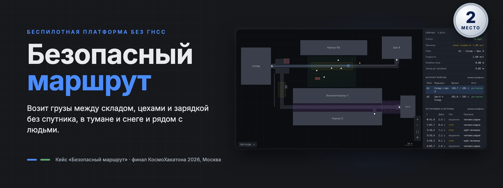](https://disk.yandex.ru/i/d9yH6T6K9AvQ0g)

Контроллер беспилотной платформы для симулятора amr-sim и рабочее место оператора к нему. Платформа возит грузы между складом, цехами и зарядкой без ГНСС в тени корпусов, в тумане и снеге и рядом с людьми. Решение кейса «Безопасный маршрут», **второе место в финале КосмоХакатона 2026** (Москва, 25–27 сентября).

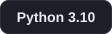 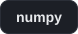 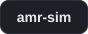 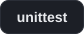 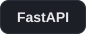 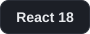 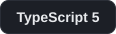  

> [!IMPORTANT]
> **Без спутника платформа не теряется.** Фильтр Калмана сводит колёса, гироскоп и лидар по карте стен, и в сценарии с длинной тенью ГНСС ошибка позиции на трёх seed не больше 0,13 м. Базовый контроллер организаторов там уходит до 5,51 м и не доставляет ни одного груза. Рядом с людьми скорость выбирается по прогнозу их движения на 3 с: на 273 прогонах финального стенда ни одного наезда, удара и нулевого сценария.

| Набор сценариев (счёт amr-sim, 0–100) | Наш контроллер | Базовый контроллер |
| --- | --- | --- |
| Открытые 01–04 и учебные 01e, 02e, seed 1–3: 18 прогонов | **99,91**, все грузы доставлены, штрафов нет | 64,33 |
| 30 сценариев, собранных по описанию скрытых, seed 1–3 | **99,88** | 23,7 |
| Те же 30, seed 4–6, которые не использовались при настройке | **99,89** | — |
| 21 стрессовый сценарий | **96,44**, нулей нет | — |

Это наши прогоны. Официальный счёт на скрытых сценариях считало жюри. Шаг контроллера в среднем меньше 1 мс при бюджете 145 мс.

<details>
<summary><strong>По сценариям: открытые и 30 скрытоподобных</strong></summary>

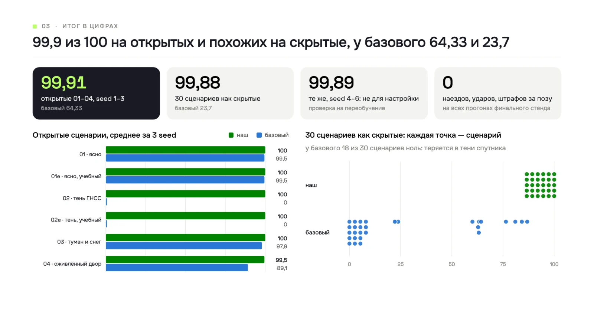

</details>

> [!TIP]
> **Посмотреть за пять минут, без симулятора:**
> 1. Скринкаст работы: [Яндекс Диск](https://disk.yandex.ru/i/d9yH6T6K9AvQ0g) или [зеркало на Google Drive](https://drive.google.com/file/d/1WJ58xhQWAZkW_kWlx_diNQCKxwykMaDs/view?usp=sharing).
> 2. Готовые прогоны в рабочем месте оператора: из корня репозитория `python3 arm/server.py --readonly` и открыть http://127.0.0.1:8765. Нужен только Python 3.10+, без numpy и без симулятора.
> 3. В списке слева выбрать «Потеря ориентации», «Оживлённый двор» или любой сценарий витрины.

## Ссылки

| Что | Где | Зачем |
| --- | --- | --- |
| **Скринкаст** | [Яндекс Диск](https://disk.yandex.ru/i/d9yH6T6K9AvQ0g) · [зеркало](https://drive.google.com/file/d/1WJ58xhQWAZkW_kWlx_diNQCKxwykMaDs/view?usp=sharing) | Рабочее место оператора в работе: прогон, сравнение, запуск, конструктор |
| Презентация | [presentation.pdf](presentation.pdf) | Версия с защиты, 12 слайдов. Цифры и графики в этом README взяты из неё |
| Подход | [APPROACH.md](APPROACH.md) | Локализация, следование и безопасность коротко, что не сделано |
| Прогоны и отчёты | [results/](results/README.md) | 18 отчётов `amrsim run` по открытым сценариям, логи для АРМ, вывод тестов |
| Дополнительные возможности | [results/features.md](results/features.md) | Каждая с прогоном, моментом в логе и местом в коде |
| Где работает и где нет | [results/showcase/](results/showcase/README.md) | 13 сценариев витрины, риски и демонстрация потери ориентации |
| Свои сценарии | [scenarios/](scenarios/README.md) | Скрытоподобные, стрессовые и написанные под конкретную возможность |
| Демо-стенд | был развёрнут на время хакатона: `saferoute.rapira-cloud.ru`, резерв `msk-hac.rapira-cloud.ru` | Сейчас выключен. Тот же сервис поднимается у себя из [web/](web/README.md), см. «Запуск у себя» |

## Критерии кейса: где это видно

| Критерий | Что сделали | Чем проверить |
| --- | --- | --- |
| **Т1. Скрытые сценарии** (25) | Генератор сценариев по описанию скрытых и тот же фильтр допуска, что у организаторов. На них и на стрессовых сценариях проверялась каждая правка | 99,88 и 99,89 на скрытоподобных, у базового 23,7, и у него 18 из 30 сценариев дают ноль. 10 своих сценариев с прогонами в [scenarios/](scenarios/README.md) |
| **Т2. Открытые сценарии** (10) | Все четыре открытых сценария и учебные проходятся на трёх seed, в том числе 02 с длинной тенью ГНСС, где базовый получает 0 | [results/README.md](results/README.md): 99,91, 18 из 18 прогонов, все миссии `delivered`, эпизодов штрафов нет |
| **Т3. Воспроизводимость** (5) | `requirements.txt` только с numpy, `APPROACH.md` сверен с кодом, команды запуска из этого README | `python -m amrsim check <repo>` даёт `result: OK`, раздел «Запуск у себя» |
| **Т4. Честность позы** (5) | Своя оценка позы, ГНСС только после χ²-проверки. При конфликте источников статус `lost` и остановка в ноль | [results/showcase/](results/showcase/README.md#потеря-ориентации-т4-о2): позу сдвигаем на 5,4 м, через 2,9 с фильтр объявляет `lost`, платформа тормозит и стоит, ещё через 3,3 с перепривязка с ошибкой 0,07 м, итог 100. Тест `tests/test_lost.py` |
| **Т5. Архитектура и код** (5) | Модули по ролям: локализация, восприятие, миссия, план, следование, безопасность. Пороги собраны в `config_team.py` | 82 теста контроллера и 27 тестов АРМ, [results/tests.txt](results/tests.txt) |
| **О1. Обоснование** (10) | Альтернативы локализации не только описаны, а реализованы и сравнены в одинаковых условиях. Свою локализацию пытались сломать: около 2 300 прогонов атак, три найденных пробоя закрыты | [APPROACH.md](APPROACH.md), таблица «Почему фильтр Калмана» ниже |
| **О2. Демо в сложных условиях** (10) | Тень ГНСС, туман и снег, невнимательные пешеходы, потеря ориентации: у каждого случая есть лог, который открывается в АРМ | `results/logs/` (02, 03, 04), `results/showcase/` (`w1`–`w3`, `lost/`), скринкаст |
| **О3. Рабочее место оператора** (15) | Две версии с одним интерфейсом: лёгкая `arm/` на стандартной библиотеке и веб-сервис `web/` на FastAPI и React. Сверх базового набора: запуск прогонов, сравнение двух прогонов, конструктор сценариев, CSV | скриншоты ниже, [arm/README.md](arm/README.md), [web/README.md](web/README.md) |
| **О4. Дополнительно** (10) | Объезд предмета, расхождение карты, сначала к точке забора, аварийное торможение, прогноз людей, свои сценарии, автотесты. Витрина «где работает и где нет» по совету экспертов | [results/features.md](results/features.md): сценарий, момент `t` и место в коде для каждой возможности |
| **О5. Презентация** (5) | На защите 12 слайдов: разбор симулятора, итог в цифрах, локализация, альтернативы, люди и предметы, демо, граница возможностей | графики с защиты в этом README и в [presentation.pdf](presentation.pdf) |

## Что умеет контроллер

| **01 · Позиция без спутника** | **02 · Люди рядом** |
| --- | --- |
| Фильтр Калмана держит позу, масштаб колёс, уход гироскопа и смещение ГНСС. Скан лидара сопоставляется с картой стен только по тем осям, которые он видит. Граница тени ГНСС есть на карте, и её пересечение даёт привязку вдоль пути. Упор в препятствие ловится по скану. | Скорость выбирается по прогнозу движения людей на 3 с: зазор не меньше 3,3 м при скорости выше 0,27 м/с и не меньше 0,8 м при любом движении. Если пешеход, которого видели идущим, стоит впереди или идёт навстречу, платформа встаёт в точный ноль, и он проходит. С места не трогается, пока любой неизвестный объект ближе 0,8 м. |
| **03 · Предметы и расхождение карты** | **04 · Миссии и док** |
| Упавший поддон объезжается боковым смещением пути внутри проезда. Аварийный стоп только тогда, когда обычным торможением уже не успеть. Если скан расходится с картой (новый забор, снесённое здание), локализация берёт только точки на известных стенах. | Если миссия начинается не у точки забора, платформа сначала едет туда по A*. Профиль скорости тормозит к зонам заранее. Заход в док по √(2ad), стоп в 1–2 см от точки, при промахе задний ход и повторный заход. |

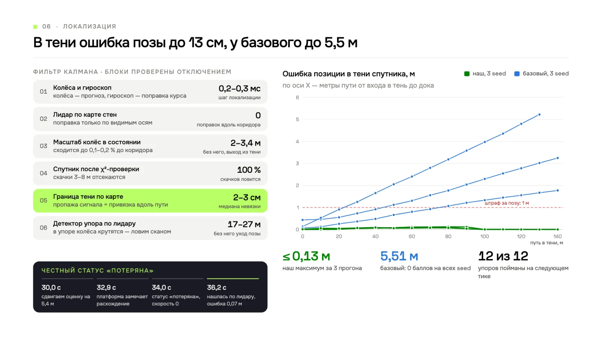

Почему фильтр Калмана, а не другие методы. Все четыре варианта реализованы и дают почти одинаковый счёт: 99,33–99,35 на открытых сценариях. Поэтому выбирали по точности, скорости и устойчивости:

| Вариант | Ошибка позы, м | Шаг локализации, мс | Баллы после искусственного сдвига позы |
| --- | --- | --- | --- |
| **Фильтр Калмана (выбран)** | **0,14** | **0,3** | **96–97** |
| Фильтр частиц, 1 000 частиц | 0,15 | 0,7–1,0 | 0: не нашёлся ни разу из 12 |
| Скользящее окно | 0,16 | — | 0 / 97: нашлось только в тени |
| Без фильтра | 0,23 | — | 94–96 |

Ошибка позы здесь медиана максимума за прогон при прогнозе по колёсам. Окно не выигрывает, потому что при точном курсе задача линейная.

## Рабочее место оператора

Две версии с одним интерфейсом. Лёгкая [arm/](arm/README.md) запускается одной командой без зависимостей. Полный веб-сервис [web/](web/README.md) на FastAPI и React работал на демо-стенде и поднимается у себя в Docker. Скриншоты настоящие: прогоны из `results/` и запуски из самого сервиса.

<table>
  <tr>
    <td width="50%" valign="top"><b>Прогон на карте</b></td>
    <td width="50%" valign="top"><b>Штраф в журнале</b></td>
  </tr>
  <tr>
    <td valign="top">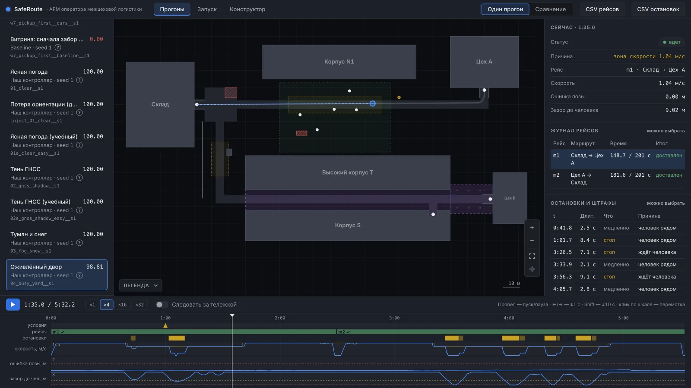</td>
    <td valign="top">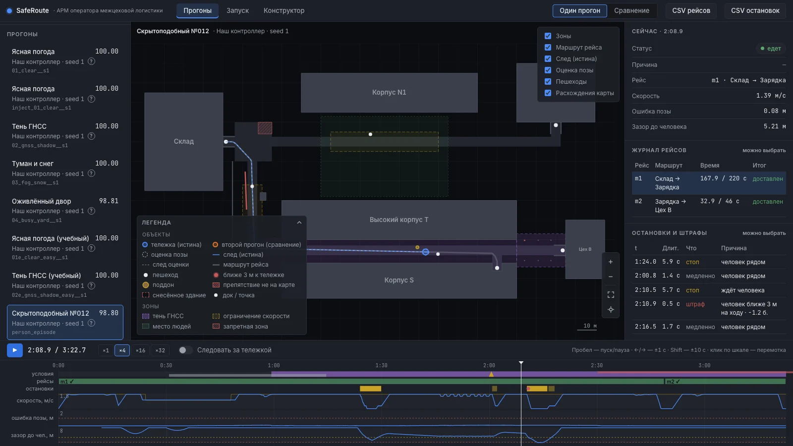</td>
  </tr>
  <tr>
    <td valign="top">Где платформа на самом деле и где она себя считает, пешеходы, статус и причина остановки. Клик по строке журнала переносит плеер в этот момент.</td>
    <td valign="top">Остановки, замедления и штрафные эпизоды из отчёта симулятора. Шкала внизу показывает условия, рейсы, скорость, ошибку позы и зазор до человека.</td>
  </tr>
  <tr>
    <td width="50%" valign="top"><b>Сравнение двух прогонов</b></td>
    <td width="50%" valign="top"><b>Честная потеря ориентации</b></td>
  </tr>
  <tr>
    <td valign="top">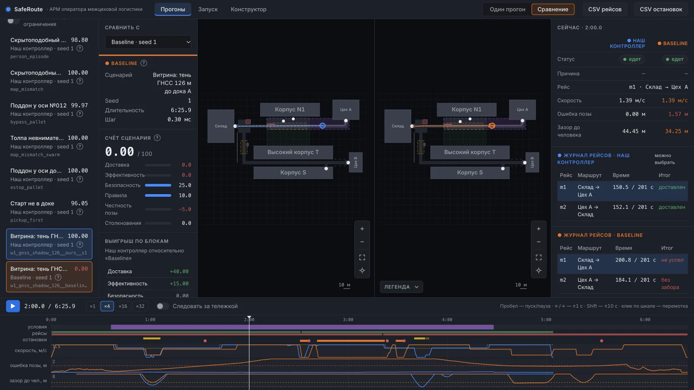</td>
    <td valign="top">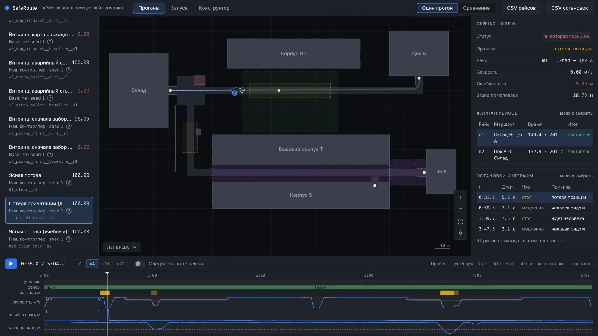</td>
  </tr>
  <tr>
    <td valign="top">Тень ГНСС 126 м: наш контроллер и базовый на общей шкале времени, счёт и выигрыш по блокам. У базового ошибка растёт, первый рейс не успевает.</td>
    <td valign="top">Позу сдвинули на 5,4 м: платформа замечает расхождение, встаёт со статусом «потерял позицию», перепривязывается и едет дальше с ошибкой 0,07 м.</td>
  </tr>
  <tr>
    <td width="50%" valign="top"><b>Запуск пачки прогонов</b></td>
    <td width="50%" valign="top"><b>Конструктор сценариев</b></td>
  </tr>
  <tr>
    <td valign="top">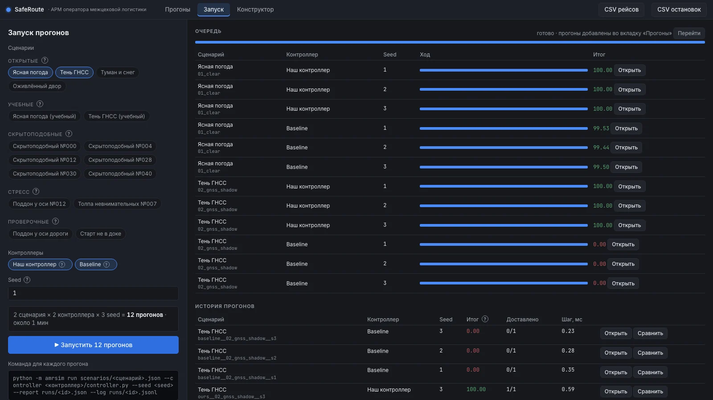</td>
    <td valign="top">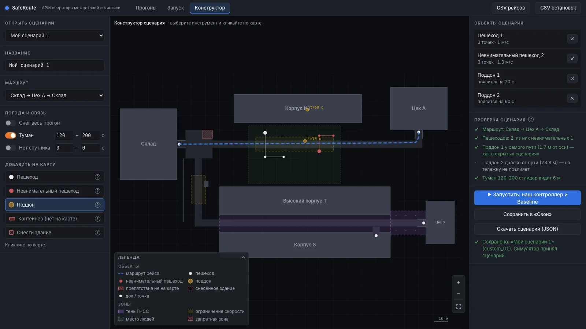</td>
  </tr>
  <tr>
    <td valign="top"><code>amrsim run</code> прямо из интерфейса: сценарии, контроллеры и seed, по два прогона одновременно. Готовые прогоны сразу появляются в списке.</td>
    <td valign="top">Поставить пешеходов, поддон, туман или снести здание, проверить схемой симулятора и запустить наш и базовый контроллер.</td>
  </tr>
</table>

<details>
<summary><strong>Все возможности рабочего места</strong></summary>

- карта площадки со сворачиваемой легендой: проезды, здания, зоны (тень ГНСС, скоростные, запретные, место людей), доки, расхождения карты с миром, упавший поддон;
- положение платформы и оценка позы контроллера, след обеих траекторий, маршрут рейса;
- пешеходы во времени, красным те, кто ближе 3 м к платформе;
- журнал рейсов (время против дедлайна, итог), остановки с причинами и эпизоды штрафов; клик переводит плеер к моменту;
- проигрывание с паузой, скоростью ×1…×32 и перемоткой, режим «следовать за тележкой»;
- сравнение двух прогонов: счёт по блокам, выигрыш, общая шкала времени;
- запуск `amrsim run` из интерфейса с результатом в списке;
- конструктор сценариев с проверкой схемой симулятора, экспорт CSV рейсов и остановок.

</details>

## Как устроено

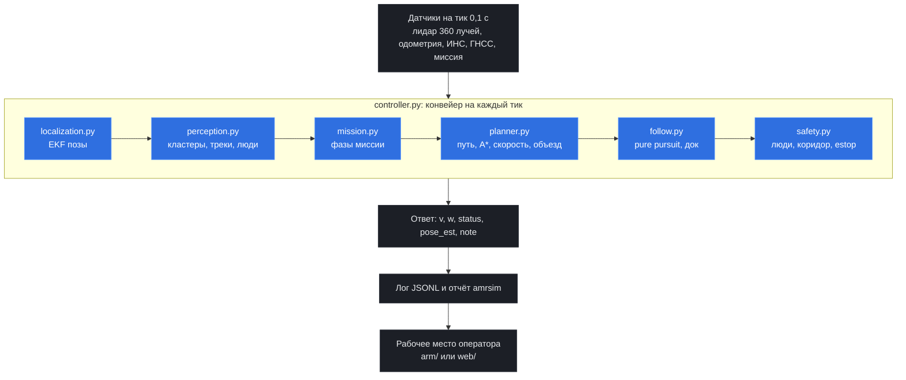

| Модуль | Что делает |
|---|---|
| `controller.py` | класс `Controller`: конвейер на тик, проверка входа и выхода, страховка шага |
| `localization.py` | `Localizer`: EKF позы с масштабом одометрии, уходом ИНС и смещением ГНСС; сканматчинг, границы тени, детектор упора, режимы «расхождение карты» и «потеряна» |
| `perception.py` | кластеры и треки неизвестных лидарных возвратов, люди с центром и скоростью, статика |
| `mission.py` | фазы миссии, флаг забора, arrived |
| `planner.py` | путь, маршрут к точке забора (A*), профиль скорости, объезд смещением (`Bypass`), трек впереди |
| `follow.py` | regulated pure pursuit, разворот на месте, задний ход и повторный заход в доке |
| `safety.py` | последний слой: люди (прогноз, уступание), коридор, «слишком близко», estop, отступ 0,3 м |
| `geometry.py` | углы, полигоны, растр знакового расстояния до стен, ray cast |
| `motion.py` | закон скорости платформы из config |
| `config_team.py` | все пороги и переключатели (`LOC_MODE = "odom"` или `"model"`) |

Коды в поле `note` ответа нужны рабочему месту оператора:
- `wait:person`, `slow:person`: стоп или замедление из-за человека;
- `wait:object`, `slow:object`: стоп перед предметом или замедление ради отступа 0,3 м;
- `bypass:object`, `estop:object`: объезд, аварийное торможение;
- `pickup`, `dock`, `zone:<v>`: фазы движения и ограничение зоны скорости;
- `mismatch:map`, `lost`, `err`: скан расходится с картой, локализация потеряна, исключение в шаге.

<details>
<summary><strong>Карта репозитория</strong></summary>

| Папка или файл | Что это |
|---|---|
| `controller.py` и модули рядом | контроллер платформы, структура выше |
| `APPROACH.md` | подход кратко |
| `tests/` | тесты контроллера (unittest, симулятор не нужен) |
| `scenarios/` | свои сценарии: скрытоподобные, стресс, проверочные, витрина `showcase/` |
| `results/` | готовые прогоны и отчёты, возможности с моментами в логах, витрина и риски |
| `arm/` | лёгкое рабочее место оператора: сервер на стандартной библиотеке и страница |
| `web/` | полный веб-сервис рабочего места: FastAPI + React, Docker (`web/docker-compose.yml`) |
| `presentation.pdf` | презентация с защиты, 12 слайдов |
| `media/` | картинки для этого README, исходник шапки в `media/src/hero.html` |

</details>

## Запуск у себя

Нужен архив симулятора организаторов `amrsim-participants`. Удобнее всего распаковать его рядом с репозиторием:

```
<папка>/
├── amrsim-participants/   # архив организаторов
└── safe-route/            # этот репозиторий
```

Ниже `<repo>` означает путь к этому репозиторию, `<sim>` путь к `amrsim-participants`.

### А. Контроллер в симуляторе

Нужны Python 3.10+ и numpy. Других зависимостей у контроллера нет.

```bash
cd <sim>
python3 -m venv .venv && . .venv/bin/activate
python -m pip install -r <repo>/requirements.txt

# статическая проверка правил
python -m amrsim check <repo>

# один сценарий
python -m amrsim run scenarios/02_gnss_shadow.json --controller <repo>/controller.py --seed 1 \
    --report out/02.json --log out/02.jsonl

# batch: репозиторий лежит в папке команд teams/<имя>/
mkdir -p teams && cp -r <repo> teams/safe-route
python -m amrsim batch teams scenarios --seeds 1,2,3 --jobs 4 --out out/batch.csv
```

`check` даёт `result: OK` без нарушений. Предупреждения (WARNING) относятся только к `arm/` и `web/`: серверы рабочего места запускают симулятор и поэтому импортируют `subprocess`, `http.server`, `threading`, `fastapi`. Контроллер эти модули не импортирует, у таких предупреждений стоит пометка «not imported by controller.py» или «blocked at run time».

### Б. Лёгкое рабочее место оператора (`arm/`)

Сервер написан только на стандартной библиотеке Python. numpy нужен интерпретатору, который запускает прогоны (подойдёт venv из варианта А). Из корня репозитория:

```bash
cd <repo>
python arm/server.py --sim <sim> --python <sim>/.venv/bin/python
# открыть http://127.0.0.1:8765, остановить: Ctrl+C
```

Если симулятор не найден (нет ни `--sim`, ни `$AMRSIM_DIR`, ни `../amrsim-participants` рядом с репозиторием) или задан `--readonly`, работает только просмотр готовых прогонов из `results/`, и тогда не нужен ни симулятор, ни numpy.

### В. Полный веб-сервис в Docker (`web/`)

Нужен Docker с Compose v2 (Docker Desktop или docker-ce). Образ собирается из `web/`, в него копируются контроллер, `scenarios/` и `results/` этого репозитория и симулятор из `<sim>`.

```bash
cd <repo>/web
AMRSIM_DIR=<sim> docker compose up --build -d   # <sim> — абсолютный путь;
                                                # если архив лежит рядом с репозиторием, AMRSIM_DIR не нужен
# открыть http://127.0.0.1:8098
docker compose logs -f     # журнал
docker compose down        # остановить (прогоны и свои сценарии сохраняются в томах docker)
docker compose down -v     # остановить и удалить тома
```

Первая сборка занимает несколько минут: скачиваются образы node и python. Папку `<sim>` Docker передаёт в сборку целиком, поэтому большую `out/` после batch лучше удалить или указать в `AMRSIM_DIR` чистую распаковку архива. Подробности в [web/README.md](web/README.md).

### Тесты

Симулятор для тестов не нужен:

```bash
python -m unittest discover tests                 # контроллер, 82 теста
python -m unittest discover -s arm/tests          # лёгкое АРМ, 27 тестов, стандартная библиотека
cd web/backend && pip install -e ".[dev]" && pytest   # веб-сервис, FastAPI
```

Что покрывают тесты контроллера:
- фильтр позы на синтетической карте;
- правила людей и estop;
- объезд, закон скорости и док;
- машина состояний миссии;
- формат ответа и битые входы;
- потеря ориентации и восстановление.

Готовые прогоны открытых сценариев и команды, которыми они получены, лежат в [results/](results/README.md). Прогоны детерминированы: при том же seed отчёт совпадает.

## Ограничения

Витрина из 13 сценариев показывает и то, где решение работает, и где его граница. Позиция не теряется ни в одном из них.

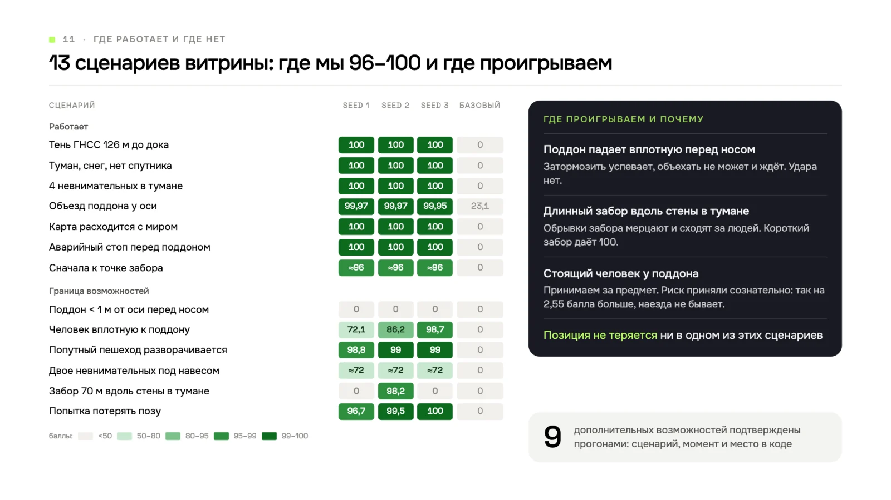

- **Поддон падает ближе 1 м к оси прямо перед платформой.** Затормозить успеваем, удара нет, но объехать не получается, итог 0 (`l1`). Базовый контроллер с истинной позой здесь тоже получает 0, поэтому фильтр допуска такие сценарии в скрытые не пускает.
- **Стоящий человек вплотную к поддону** сливается с ним в один «предмет»: 72,11 / 86,24 / 98,70 на трёх seed (`l2`). На seed 2 платформа проезжает мимо человека в 0,56 м на 1,39 м/с, штраф −13,2. Риск принят сознательно: вариант «всё неизвестное и неподвижное считать человеком» стоит 2,55 балла на скрытоподобных. Обнуления и наезда этот случай не даёт.
- **Попутный пешеход разворачивается впереди**: около −1 балла за эпизод (`l3`). Прогноз считает скорость человека постоянной.
- **Двое невнимательных пешеходов под навесом**: каждое пересечение означает полную остановку, плечу не хватает времени, около 72 балла (`l4`).
- **Длинный незнакомый забор вплотную к стене в тумане**: обрывки забора принимаются за людей, таймаут на 2 seed из 3 (`l5`). Базовый контроллер с истинной позой здесь набирает 100, так что это слабость нашего восприятия. Забор в 70 м длиннее тех, что делает генератор организаторов (6–20 м).
- **Скачок оценки позы незадолго до дока**, если он всё же случится: платформа может встать не в той точке, и следующая миссия не начнётся. В сценариях комплекта скачков у фильтра не было.
- **Упор боком под углом до 3°** лидаром не различим. Закрыт отступом 0,3 м от стен, в допустимых сценариях не встречался.
- **Не сделано:** выбор режима локализации на лету, проскок перед пешеходом, отдельная дистанция следования за попутным пешеходом.
- **Всё проверено в симуляторе.** Проскальзывания колёс и погрузчиков в нём нет, на реальной платформе их пришлось бы добавить.

Подробно, с моментами в логах и местами в коде: [results/showcase/README.md](results/showcase/README.md).

Команда «Рапира Клауд», второе место в финале КосмоХакатона 2026.
